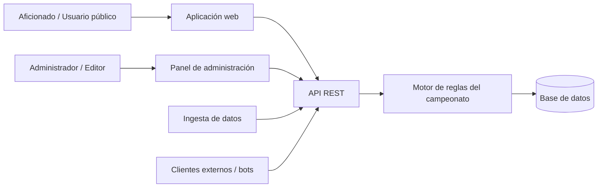
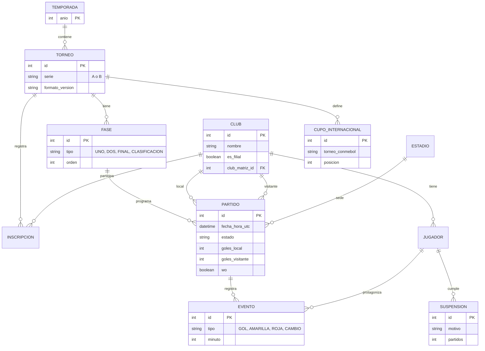

# Especificación de Requisitos de Software (SRS)

## Plataforma de Gestión y Consulta de la LigaPro Ecuador (Serie A y Serie B)

| Campo | Valor |
|---|---|
| **Proyecto** | LigaPro Hub (nombre provisional) |
| **Versión del documento** | 0.1 (Borrador) |
| **Estándar de referencia** | IEEE 830 / ISO/IEC/IEEE 29148 (adaptado) |
| **Idioma** | Español (Ecuador) |
| **Base normativa** | Reglamento de Competiciones de la LigaPro, v. julio 2023 |
| **Estado** | Borrador para revisión |

> **Aviso:** este proyecto es una iniciativa independiente. No está afiliado, patrocinado ni respaldado por la Liga Profesional de Fútbol del Ecuador (LigaPro) ni por la Federación Ecuatoriana de Fútbol (FEF). Los nombres y marcas pertenecen a sus titulares.

---

## Tabla de contenido

1. [Introducción](#1-introducción)
2. [Descripción general](#2-descripción-general)
3. [Requisitos específicos](#3-requisitos-específicos)
4. [Reglas de negocio](#4-reglas-de-negocio-derivadas-del-reglamento)
5. [Requisitos no funcionales](#5-requisitos-no-funcionales)
6. [Modelo de datos conceptual](#6-modelo-de-datos-conceptual)
7. [Criterios de aceptación](#7-criterios-de-aceptación)
8. [Apéndices](#8-apéndices)

---

## 1. Introducción

### 1.1 Propósito

Este documento define los requisitos funcionales y no funcionales de una plataforma de software que permita **registrar, calcular y consultar** la información de los campeonatos de la LigaPro de Ecuador (Serie A y Serie B): clubes, calendario, resultados, tablas de posiciones, desempates, tarjetas, clasificaciones, ascensos y descensos.

Está dirigido a desarrolladores, diseñadores, testers y colaboradores de la comunidad open source que participen en el repositorio.

### 1.2 Alcance

**Dentro del alcance:**

- Gestión de temporadas, series, fases, clubes, partidos y resultados.
- Cálculo automático de tablas (Fase Uno, Fase Dos, Acumulada y fase de clasificación de Serie B) aplicando los criterios de desempate del reglamento.
- Determinación de campeón, vicecampeón, finalistas, ascensos y descensos.
- Control de tarjetas amarillas y rojas, y suspensiones por acumulación.
- Consulta pública (web y API REST) de calendario, resultados y tablas, con horarios en hora de Ecuador.
- Simulador de escenarios (qué necesita un club para clasificar, ascender o salvarse).

**Fuera del alcance (versión 1.0):**

- Venta de entradas, apuestas deportivas o contenido audiovisual.
- Gestión de sanciones disciplinarias complejas (tribunales, apelaciones, multas económicas detalladas).
- Segunda Categoría, torneos juveniles, fútbol femenino y torneos CONMEBOL (solo se modela la *clasificación* a estos como dato informativo).
- Licencias de clubes, control económico y registro de jugadores.

### 1.3 Definiciones, acrónimos y abreviaturas

| Término | Definición |
|---|---|
| **LigaPro** | Liga Profesional de Fútbol del Ecuador. |
| **FEF** | Federación Ecuatoriana de Fútbol. |
| **Serie A** | Primera categoría, 16 clubes según el reglamento v. julio 2023. |
| **Serie B** | Segunda división profesional, 10 clubes según el reglamento v. julio 2023. |
| **Fase Uno / Fase Dos / Fase Final** | Fases del campeonato de Serie A. |
| **Tabla Acumulada** | Suma de Fase Uno y Fase Dos (no incluye la Fase Final). |
| **Fase de clasificación** | Fase única de la Serie B (dos ruedas, ida y vuelta). |
| **Filial** | Club filial de otro club; no puede ascender a Serie A. |
| **W.O.** | Derrota administrativa por incomparecencia o abandono (3-0). |
| **ECT** | Hora de Ecuador continental (UTC-5, sin horario de verano). |
| **RF / RNF / RN** | Requisito funcional / no funcional / regla de negocio. |
| **MoSCoW** | Priorización: *Must*, *Should*, *Could*, *Won't*. |

### 1.4 Referencias

- Reglamento de Competiciones de la LigaPro, v. julio 2023 (aprobado el 18/12/2018 y reformado por resoluciones del Consejo de Presidentes hasta el 18/07/2023).
- Reglas de Juego del IFAB.
- IEEE Std 830-1998 e ISO/IEC/IEEE 29148:2018.
- Sitio oficial de la LigaPro: <https://www.ligapro.ec>

### 1.5 Visión general del documento

La sección 2 describe el producto y sus usuarios. La sección 3 lista los requisitos funcionales. La sección 4 formaliza las reglas del reglamento que el sistema debe implementar. Las secciones 5 a 7 cubren calidad, datos y aceptación. Los apéndices incluyen trazabilidad, riesgos y hoja de ruta.

---

## 2. Descripción general

### 2.1 Perspectiva del producto

LigaPro Hub es un sistema independiente compuesto por:

- **Backend / API REST** con el motor de reglas del campeonato.
- **Aplicación web** (responsive) de consulta pública y panel de administración.
- **Base de datos relacional** con el histórico por temporada.
- **Módulo de ingesta de datos** (carga manual por administradores y, opcionalmente, importación desde fuentes autorizadas).

### 2.2 Funciones principales del producto

1. Configurar temporadas y formatos de competencia sin modificar el código.
2. Generar el fixture y gestionar la programación de partidos.
3. Registrar resultados y eventos (goles, tarjetas).
4. Calcular tablas y aplicar desempates oficiales.
5. Determinar finalistas, campeón, vicecampeón, ascensos y descensos.
6. Publicar calendario, resultados y tablas en hora de Ecuador.
7. Simular escenarios de clasificación y descenso.

### 2.3 Tipos de usuario

| Rol | Descripción | Permisos principales |
|---|---|---|
| **Visitante** | Usuario anónimo. | Consultar tablas, calendario, resultados, clubes. |
| **Usuario registrado** | Aficionado con cuenta. | Lo anterior, más favoritos y notificaciones. |
| **Editor** | Responsable de cargar resultados. | Crear y editar partidos, resultados y eventos. |
| **Administrador** | Responsable de la configuración. | Gestionar temporadas, formatos, clubes, usuarios y reglas. |
| **Cliente API** | Aplicación externa. | Lectura vía API con clave (límite de uso). |

### 2.4 Restricciones

- **RES-01:** las reglas deben seguir el Reglamento de Competiciones vigente. El formato aprobado en 2020 regía por 5 temporadas (2020-2024); el sistema **no debe asumir** que el formato permanece fijo.
- **RES-02:** los horarios se muestran por defecto en **ECT (UTC-5)**.
- **RES-03:** el uso de datos, escudos, logotipos y calendarios de terceros debe respetar sus términos y derechos de autor.
- **RES-04:** el proyecto es de código abierto; la licencia se define en la sección 8.4.

### 2.5 Supuestos y dependencias

- **SUP-01:** el reglamento v. julio 2023 es la base normativa de la versión 1.0. Reformas posteriores se incorporan mediante configuración.
- **SUP-02:** no se asume la existencia de una API oficial pública de la LigaPro. La fuente de datos se resolverá por carga manual o por fuentes con permiso de uso.
- **SUP-03:** el reglamento **no fija** la cantidad de cupos a Copa Libertadores y Copa Sudamericana; esa información se carga cada temporada como dato de configuración.
- **DEP-01:** servicio de alojamiento, base de datos y correo electrónico.

---

## 3. Requisitos específicos

Prioridad según MoSCoW: **M** = Must, **S** = Should, **C** = Could.

### 3.1 Requisitos de interfaces externas

| ID | Requisito |
|---|---|
| **RI-01** | La interfaz web será responsive (móvil, tableta y escritorio) y accesible. |
| **RI-02** | La API REST seguirá la especificación OpenAPI 3.x y devolverá JSON. |
| **RI-03** | Las fechas en la API se entregan en ISO 8601 con zona horaria explícita (por ejemplo `2026-11-23T19:30:00-05:00`). |
| **RI-04** | Se podrá exportar tablas y calendario en CSV y JSON. |
| **RI-05** | Se podrán enviar notificaciones por correo electrónico y *web push* (opcional). |

### 3.2 Requisitos funcionales

#### 3.2.1 Configuración de temporada y formato

| ID | Requisito | Prioridad |
|---|---|---|
| **RF-01** | El administrador podrá crear una temporada (año) con una o más series (A y B). | M |
| **RF-02** | Cada serie tendrá un formato configurable: número de clubes, fases, ruedas, partidos de ida y vuelta, criterios de desempate y reglas de ascenso y descenso. | M |
| **RF-03** | El sistema incluirá plantillas de formato precargadas: **Serie A (16 clubes: Fase Uno, Fase Dos, Fase Final)** y **Serie B (10 clubes: fase de clasificación a dos ruedas)**, conforme al reglamento v. julio 2023. | M |
| **RF-04** | Los formatos deberán versionarse, de modo que una temporada histórica conserve el formato con el que se jugó. | S |
| **RF-05** | El administrador podrá registrar los cupos a Copa Libertadores y Copa Sudamericana de cada temporada y la posición que da acceso a cada uno. | S |

#### 3.2.2 Clubes y estadios

| ID | Requisito | Prioridad |
|---|---|---|
| **RF-06** | CRUD de clubes: nombre, abreviatura, escudo, ciudad, colores y bandera de **filial** (sí/no, y a qué club pertenece). | M |
| **RF-07** | CRUD de estadios y asignación del estadio de localía de cada club por temporada. | S |
| **RF-08** | Inscripción de clubes en una serie y temporada, validando que no se supere el cupo definido en el formato. | M |

#### 3.2.3 Calendario y programación

| ID | Requisito | Prioridad |
|---|---|---|
| **RF-09** | Generar el fixture de la Fase Uno (todos contra todos, solo ida, 15 partidos por club en Serie A). | M |
| **RF-10** | Generar el fixture de la Fase Dos (todos contra todos, vuelta, 15 partidos por club en Serie A). | M |
| **RF-11** | Generar el fixture de la Serie B (dos ruedas con ida y vuelta, 36 partidos por club para 10 clubes). | M |
| **RF-12** | Programar fecha, hora y estadio de cada partido y permitir su reprogramación conservando el historial de cambios. | M |
| **RF-13** | Alertar si la notificación de fecha y horario se realiza con menos de 15 días de anticipación. | C |
| **RF-14** | Marcar como **horario unificado** los partidos de las dos últimas fechas de cada fase cuando sus resultados puedan incidir entre sí. | S |
| **RF-15** | Advertir la programación de partidos de Serie A en fechas FIFA (no permitido); en Serie B se permite. | C |
| **RF-16** | Registrar postergaciones por compromisos CONMEBOL o FIFA y el motivo. | C |
| **RF-17** | Mostrar todos los horarios en **ECT (UTC-5)** por defecto, con opción de visualizar en la zona horaria del usuario. | M |

#### 3.2.4 Resultados y estado de los partidos

| ID | Requisito | Prioridad |
|---|---|---|
| **RF-18** | Cada partido tendrá un estado: *Programado*, *En vivo*, *Finalizado*, *Suspendido*, *Reprogramado*, *Perdido por W.O.*. | M |
| **RF-19** | El editor podrá registrar el marcador y los eventos (goles con minuto, tarjetas amarillas y rojas, cambios). | M |
| **RF-20** | Al registrar un W.O. (incomparecencia, falta de planilla o abandono), el sistema asignará **3-0 y tres puntos** al rival (o el marcador real si la diferencia fuera mayor). | M |
| **RF-21** | Registrar la suspensión definitiva y su reanudación desde el minuto y marcador de la interrupción. | C |
| **RF-22** | Registrar sustituciones validando el máximo de **5 cambios** por equipo y **3 momentos** de cambio. | C |
| **RF-23** | Validar que la planilla tenga como máximo 23 jugadores convocados (11 titulares y 12 suplentes). | C |
| **RF-24** | Toda modificación de un resultado quedará auditada (usuario, fecha, valor anterior y nuevo). | M |

#### 3.2.5 Tablas de posiciones y desempates

| ID | Requisito | Prioridad |
|---|---|---|
| **RF-25** | Calcular la tabla de posiciones de la **Fase Uno** (PJ, PG, PE, PP, GF, GC, DG, Pts). | M |
| **RF-26** | Calcular la tabla de la **Fase Dos reiniciando los puntos a cero**. | M |
| **RF-27** | Calcular la **Tabla Acumulada** (Fase Uno + Fase Dos), excluyendo los partidos de la Fase Final. | M |
| **RF-28** | Calcular la tabla de la **fase de clasificación de Serie B**. | M |
| **RF-29** | Aplicar los criterios de desempate oficiales de cada tabla, en el orden definido en la sección 4. | M |
| **RF-30** | Cuando el desempate se resuelva por **sorteo público**, permitir al administrador registrar el resultado del sorteo con evidencia (acta o enlace). | S |
| **RF-31** | Indicar en la tabla qué criterio de desempate resolvió cada empate (transparencia). | S |
| **RF-32** | Calcular tablas por jornada (estado de la tabla a una fecha determinada). | S |
| **RF-33** | Resaltar zonas: final, clasificación internacional, ascenso y descenso. | S |

#### 3.2.6 Clasificación, campeón, ascensos y descensos

| ID | Requisito | Prioridad |
|---|---|---|
| **RF-34** | Determinar los clasificados a la Fase Final: el 1.º de la Fase Uno y el 1.º de la Fase Dos. | M |
| **RF-35** | Si un mismo club es 1.º en ambas fases, proclamarlo **campeón directo** sin Fase Final; el vicecampeón será el mejor ubicado siguiente en la Tabla Acumulada. | M |
| **RF-36** | Si un clasificado a la Fase Final termina 15.º o 16.º en la Tabla Acumulada, reemplazarlo por el mejor ubicado de la Tabla Acumulada y aplicar la regla de campeón directo cuando corresponda. | M |
| **RF-37** | Gestionar la Fase Final a ida y vuelta: la vuelta la juega de local el club mejor ubicado en la Tabla Acumulada; si hay igualdad de puntos y goles, definir por penales (sin tiempo extra). | M |
| **RF-38** | Determinar los **dos descensos** de Serie A (posiciones 15.º y 16.º de la Tabla Acumulada) tras los 30 partidos. | M |
| **RF-39** | Determinar los **dos ascensos** de Serie B (1.º y 2.º de la fase de clasificación), omitiendo a los **clubes filiales** y ascendiendo al siguiente mejor ubicado. | M |
| **RF-40** | Determinar los **dos descensos** de Serie B a Segunda Categoría (posiciones 9.º y 10.º). | M |
| **RF-41** | Asignar la clasificación a Copa Libertadores y Copa Sudamericana según los cupos configurados (RF-05). | S |

#### 3.2.7 Tarjetas y suspensiones

| ID | Requisito | Prioridad |
|---|---|---|
| **RF-42** | Acumular tarjetas amarillas por jugador (consecutivas o alternadas) y generar **suspensión de un partido** al llegar a la quinta. | M |
| **RF-43** | **Borrar las amarillas acumuladas** al inicio de cada fase. | M |
| **RF-44** | Calcular la multa de referencia por tarjetas: Serie A, USD 20 por amarilla y USD 100 por expulsión; Serie B, USD 10 y USD 50 (parámetros configurables). | C |
| **RF-45** | Mostrar el estado de suspensión de cada jugador para la siguiente fecha. | S |
| **RF-46** | Registrar suspensiones por expulsión y otras sanciones cargadas manualmente. | S |

#### 3.2.8 Consulta pública

| ID | Requisito | Prioridad |
|---|---|---|
| **RF-47** | Pantalla de inicio con la jornada actual, resultados recientes y próximos partidos. | M |
| **RF-48** | Consulta de tablas por serie y fase, con filtros por temporada. | M |
| **RF-49** | Calendario por club, por jornada y por estadio. | M |
| **RF-50** | Ficha de club con plantilla, histórico de la temporada y posición actual. | S |
| **RF-51** | Ficha de partido con marcador, eventos, alineaciones y estado, claramente diferenciado como *Finalizado*, *En vivo* o *Por jugar*. | M |
| **RF-52** | Histórico de temporadas anteriores (campeones, ascensos y descensos). | C |
| **RF-53** | Búsqueda de clubes y jugadores. | S |

#### 3.2.9 Simulador de escenarios

| ID | Requisito | Prioridad |
|---|---|---|
| **RF-54** | Permitir al usuario ingresar resultados hipotéticos de los partidos pendientes y recalcular tablas aplicando los desempates. | S |
| **RF-55** | Calcular y mostrar, para cada club, si está **matemáticamente** clasificado, salvado, descendido o ascendido. | S |
| **RF-56** | Distinguir en la interfaz entre cálculo matemático y proyección (hipótesis del usuario). | S |

#### 3.2.10 Cuentas, notificaciones y administración

| ID | Requisito | Prioridad |
|---|---|---|
| **RF-57** | Registro e inicio de sesión (correo electrónico y proveedores OAuth). | S |
| **RF-58** | Los usuarios podrán seguir clubes y recibir notificaciones de inicio de partido, goles y resultado final. | C |
| **RF-59** | Gestión de usuarios y roles (visitante, registrado, editor, administrador). | M |
| **RF-60** | Emisión y revocación de claves de API con límites de uso. | C |
| **RF-61** | Registro de auditoría de acciones administrativas. | M |

---

## 4. Reglas de negocio derivadas del reglamento

Las siguientes reglas son la **fuente de verdad** del motor de reglas. Las referencias corresponden al Reglamento de Competiciones v. julio 2023.

### 4.1 Serie A

| ID | Regla | Referencia |
|---|---|---|
| **RN-01** | El campeonato de Serie A se juega con **16 clubes** en tres fases: Fase Uno, Fase Dos y Fase Final. | Art. 8 |
| **RN-02** | **Fase Uno:** partidos de ida, todos contra todos (15 partidos por club). El 1.º de la tabla clasifica a la Fase Final. | Art. 9 |
| **RN-03** | **Fase Dos:** los puntajes se reinician a cero; partidos de vuelta, todos contra todos (15 partidos por club). El 1.º de la tabla clasifica a la Fase Final. Los puntos de la Fase Uno solo pasan a la Tabla Acumulada. | Art. 10 |
| **RN-04** | **Fase Final:** los clasificados juegan ida y vuelta por el título. El club mejor ubicado en la Tabla Acumulada juega la vuelta como local. Si hay igualdad de puntos y goles al término de la vuelta, se define por penales, sin tiempo extra. | Art. 11 |
| **RN-05** | El club que sea 1.º en la Fase Uno y en la Fase Dos es **campeón directo**; no se juega la Fase Final. El vicecampeón es el siguiente mejor ubicado en la Tabla Acumulada. | Art. 12 |
| **RN-06** | Si un clasificado a la Fase Final termina 15.º o 16.º en la Tabla Acumulada, pierde el derecho a disputarla y lo reemplazan los mejores ubicados de la Tabla Acumulada. Si el 1.º de una fase también es 1.º de la acumulada, es campeón directo. | Art. 13 |
| **RN-07** | Terminados los **30 partidos**, los dos últimos de la Tabla Acumulada (15.º y 16.º) descienden a Serie B. | Art. 14 |
| **RN-08** | El 3.º al 8.º puesto y siguientes se establecen según la Tabla Acumulada, sin computar la Fase Final. El campeón y vicecampeón son 1.º y 2.º. | Disp. General Tercera |

### 4.2 Serie B

| ID | Regla | Referencia |
|---|---|---|
| **RN-09** | La Serie B se juega en **una sola fase** (fase de clasificación). | Art. 15 |
| **RN-10** | Participan **10 equipos** en dos ruedas con ida y vuelta cada una (**36 partidos** por equipo). | Art. 16 |
| **RN-11** | El 1.º es campeón y el 2.º vicecampeón de Serie B. | Art. 18 |
| **RN-12** | Los dos primeros **ascienden** a Serie A. El ascenso no aplica a clubes filiales; asciende el siguiente mejor ubicado. | Art. 19, 22; Disp. Transitoria Cuarta |
| **RN-13** | Los dos últimos (9.º y 10.º) **descienden** a la Segunda Categoría. | Art. (…) tras Art. 22 |

### 4.3 Criterios de desempate

**Tabla de Fase Uno** (Art. 9) y **tabla de Fase Dos** (Art. 10), en este orden:

1. Mejor diferencia de goles (goles marcados menos goles recibidos).
2. Mayor número de goles marcados.
3. Mejor desempeño en el partido que se enfrentaron (en la Fase Dos, el de esa fase).
4. Sorteo público realizado por la LigaPro.

**Tabla Acumulada de Serie A** (Art. (…) tras Art. 14), en este orden:

1. Mejor diferencia de goles.
2. Mayor número de goles marcados.
3. Mayor número de goles como visitante.
4. Mejor desempeño: mayor cantidad de puntos en los partidos de Fase Uno y Fase Dos entre los clubes involucrados.
5. Sorteo público realizado por la LigaPro.

**Fase de clasificación de Serie B** (Art. 17), en este orden:

1. Mejor diferencia de goles.
2. Mayor número de goles marcados.
3. Mayor número de goles como visitante.
4. Mejor desempeño: mayor cantidad de puntos en los partidos entre los clubes involucrados.
5. Sorteo público realizado por la LigaPro.

### 4.4 Partidos, tarjetas y otras reglas

| ID | Regla | Referencia |
|---|---|---|
| **RN-14** | Si un club no se presenta o no presenta la planilla, se esperan **40 minutos**; vencido ese plazo pierde los puntos y su rival recibe **3-0**. En la reanudación del segundo tiempo la espera es de 20 minutos. | Art. 62 |
| **RN-15** | Si un equipo no se presenta (salvo fuerza mayor), se niega a continuar o abandona el campo, pierde el partido con marcador 3-0 (o mayor si ya era superior). Por fuerza mayor, el partido se reprograma. | Art. 81 |
| **RN-16** | La **quinta tarjeta amarilla** (consecutiva o alternada) suspende al jugador por el siguiente partido, sin importar la fase. Las amarillas se **borran al inicio de cada fase**. | Art. 91 |
| **RN-17** | Multas por tarjetas: Serie A, USD 20 por amarilla y USD 100 por expulsión; Serie B, USD 10 y USD 50. | Art. 91 |
| **RN-18** | Los clubes son responsables del control de sus tarjetas y suspensiones. | Art. 91 |
| **RN-19** | Máximo **5 sustituciones** por equipo, en un máximo de **3 momentos** por partido. | Disp. General Cuarta |
| **RN-20** | Planilla de juego: máximo 23 jugadores (11 titulares y 12 suplentes) y 10 integrantes del cuerpo técnico y staff, con médico y director técnico obligatorios. | Art. 45 |
| **RN-21** | Un equipo puede iniciar el partido con un mínimo de **7 jugadores** identificados. | Art. 47 |
| **RN-22** | Las fechas y horarios se notifican con al menos **15 días** de anticipación; solo la LigaPro puede modificarlos. | Art. 25 |
| **RN-23** | No se programan partidos de Serie A en fechas FIFA; en Serie B sí se pueden programar. | Art. 26 |
| **RN-24** | Las **dos últimas fechas** de cada fase, cuando sus resultados puedan incidir entre sí, se juegan en **horario unificado**. | Art. 27 |
| **RN-25** | Postergación o anticipación de **24 horas** por partido internacional CONMEBOL o FIFA dentro de 48 horas antes o después; las semifinales y finales internacionales se reprograman según la Dirección de Competiciones. | Art. 28 |
| **RN-26** | Un partido suspendido definitivamente se reprograma a las 19h00 del día siguiente (o 12h00 sin público) y se reanuda desde el minuto y marcador de la interrupción. | Art. 79 |

> **Importante:** el reglamento aplicable en cada temporada puede cambiar. El motor de reglas debe leer estas reglas desde configuración versionada (ver RF-04) y no desde código fijo.

---

## 5. Requisitos no funcionales

| ID | Categoría | Requisito |
|---|---|---|
| **RNF-01** | Rendimiento | Las páginas de consulta cargarán en menos de 2,5 s (LCP) en conexión 4G. |
| **RNF-02** | Rendimiento | El recálculo de una tabla tras registrar un resultado tardará menos de 2 s. |
| **RNF-03** | Escalabilidad | Soportar picos de tráfico en días de partido (por ejemplo, 50 000 solicitudes/minuto) mediante caché y CDN. |
| **RNF-04** | Disponibilidad | Disponibilidad objetivo del 99,5 % mensual. |
| **RNF-05** | Exactitud | Las tablas deben coincidir al 100 % con el reglamento; el motor tendrá pruebas automatizadas de desempates (sección 7). |
| **RNF-06** | Seguridad | Autenticación segura, contraseñas con hash robusto, protección contra OWASP Top 10, HTTPS obligatorio. |
| **RNF-07** | Seguridad | Control de acceso por roles (RBAC) y límites de uso en la API. |
| **RNF-08** | Privacidad | Cumplir con la normativa ecuatoriana de protección de datos personales; mínimo de datos del usuario. |
| **RNF-09** | Usabilidad | Interfaz en español; accesibilidad WCAG 2.1 nivel AA. |
| **RNF-10** | Mantenibilidad | Reglas del campeonato configurables y versionadas; cobertura de pruebas unitarias ≥ 80 % en el motor de reglas. |
| **RNF-11** | Portabilidad | Despliegue con contenedores (Docker) y configuración mediante variables de entorno. |
| **RNF-12** | Localización | Zona horaria por defecto `America/Guayaquil` (UTC-5); soporte para `America/Galapagos` (UTC-6) cuando aplique. |
| **RNF-13** | Observabilidad | Registro estructurado de logs, métricas y alertas básicas. |
| **RNF-14** | Calidad de datos | Todo dato publicado indicará su fuente y fecha de última actualización. |
| **RNF-15** | Legal | No reproducir contenido protegido sin licencia; respetar términos de uso de las fuentes. |

---

## 6. Modelo de datos conceptual

**Notas de diseño**

- Las fechas se almacenan en **UTC** y se presentan en ECT.
- Las tablas de posiciones se **derivan** de los partidos; no se almacenan como fuente de verdad (pueden cachearse).
- El campo `formato_version` enlaza cada torneo con el conjunto de reglas con el que se jugó.

### 6.1 Arquitectura sugerida (no vinculante)

| Capa | Opciones sugeridas |
|---|---|
| Frontend | React / Next.js con TypeScript |
| Backend | Node.js (NestJS) o Python (FastAPI) |
| Base de datos | PostgreSQL |
| Caché | Redis |
| Infraestructura | Docker, GitHub Actions para CI/CD |
| Documentación API | OpenAPI / Swagger |

---

## 7. Criterios de aceptación

### 7.1 Desempates (ejemplos de pruebas automatizadas)

| Caso | Entrada | Resultado esperado |
|---|---|---|
| **CA-01** | Dos clubes igualados en puntos en la Fase Uno; A tiene DG +5 y B tiene DG +3. | A queda por encima de B (criterio 1). |
| **CA-02** | Igualdad de puntos y DG; A marcó 20 goles y B marcó 18. | A queda por encima (criterio 2). |
| **CA-03** | Igualdad en puntos, DG y goles a favor en la Fase Uno; A ganó el partido directo. | A queda por encima (criterio 3). |
| **CA-04** | Igualdad en los tres primeros criterios de la Tabla Acumulada; A marcó más goles de visitante. | A queda por encima (criterio 3 de la acumulada). |
| **CA-05** | Empate persistente tras todos los criterios deterministas. | El sistema solicita registrar el resultado del **sorteo público** y lo marca como criterio decisivo. |

### 7.2 Campeón, ascensos y descensos

| Caso | Entrada | Resultado esperado |
|---|---|---|
| **CA-06** | El mismo club es 1.º en Fase Uno y Fase Dos. | Campeón directo; no se genera la Fase Final; vicecampeón = mejor ubicado siguiente en la Tabla Acumulada. |
| **CA-07** | El 1.º de la Fase Dos termina 16.º en la Tabla Acumulada. | Pierde el derecho a la Fase Final y es reemplazado por el mejor ubicado de la Tabla Acumulada. |
| **CA-08** | Finaliza la fase regular de Serie A (30 partidos). | Los clubes 15.º y 16.º de la Tabla Acumulada quedan marcados como descendidos. |
| **CA-09** | En Serie B, el 2.º de la fase de clasificación es filial. | Asciende el siguiente mejor ubicado que no sea filial. |
| **CA-10** | Finaliza la Serie B (36 partidos por club). | Los clubes 9.º y 10.º descienden a Segunda Categoría. |

### 7.3 Partidos y tarjetas

| Caso | Entrada | Resultado esperado |
|---|---|---|
| **CA-11** | Un club no se presenta y vencen los 40 minutos de espera. | Partido 0-3 para el rival; tres puntos al rival. |
| **CA-12** | Un jugador recibe su quinta amarilla en la Fase Uno. | Queda suspendido para el siguiente partido. |
| **CA-13** | Comienza la Fase Dos. | Las amarillas acumuladas de todos los jugadores se reinician a cero. |
| **CA-14** | Se intenta registrar una sexta sustitución para un equipo. | El sistema rechaza el registro. |

### 7.4 Horarios

| Caso | Entrada | Resultado esperado |
|---|---|---|
| **CA-15** | Partido guardado como `2026-11-24T00:30:00Z`. | Se muestra como **23 nov, 19:30 ECT**. |

---

## 8. Apéndices

### 8.1 Matriz de trazabilidad (resumen)

| Regla de negocio | Requisitos funcionales | Criterios de aceptación |
|---|---|---|
| RN-01 a RN-04 | RF-03, RF-09, RF-10, RF-25 a RF-27, RF-34, RF-37 | CA-01 a CA-04 |
| RN-05, RN-06 | RF-35, RF-36 | CA-06, CA-07 |
| RN-07 | RF-38 | CA-08 |
| RN-09 a RN-13 | RF-11, RF-28, RF-39, RF-40 | CA-09, CA-10 |
| Desempates (4.3) | RF-29 a RF-31 | CA-01 a CA-05 |
| RN-14, RN-15 | RF-20 | CA-11 |
| RN-16, RN-17 | RF-42 a RF-45 | CA-12, CA-13 |
| RN-19 a RN-21 | RF-22, RF-23 | CA-14 |
| RN-22 a RN-25 | RF-12 a RF-17 | CA-15 |

### 8.2 Riesgos

| ID | Riesgo | Probabilidad | Impacto | Mitigación |
|---|---|---|---|---|
| **R-01** | El formato de torneo cambia (el esquema 2020-2024 vence tras la temporada 2024). | Alta | Alto | Formatos versionados y configurables (RF-02, RF-04). |
| **R-02** | No existe fuente oficial de datos accesible. | Media | Alto | Carga manual por editores y fuentes con permiso. |
| **R-03** | Uso indebido de marcas, escudos o contenido protegido. | Media | Alto | Revisión legal, uso de recursos con licencia. |
| **R-04** | Errores de captura de resultados. | Media | Medio | Auditoría, doble verificación y bitácora de cambios. |
| **R-05** | Picos de tráfico en días de partido. | Alta | Medio | Caché, CDN y escalado horizontal. |

### 8.3 Hoja de ruta propuesta

| Hito | Contenido |
|---|---|
| **v0.1** | Modelo de datos, motor de reglas (tablas y desempates) con pruebas automatizadas. |
| **v0.2** | CRUD de clubes, partidos y resultados; API de lectura. |
| **v0.3** | Aplicación web de consulta (tablas, calendario, resultados) en ECT. |
| **v0.4** | Tarjetas, suspensiones, campeón, ascensos y descensos. |
| **v0.5** | Simulador de escenarios y panel de administración. |
| **v1.0** | Cuentas de usuario, notificaciones, API pública con claves y documentación completa. |

### 8.4 Contribución y licencia

- Se recomienda una licencia abierta (por ejemplo MIT o Apache-2.0); definir antes de la primera publicación.
- Flujo de contribución sugerido: *fork*, rama por funcionalidad, *pull request* con pruebas y revisión.
- Los cambios en reglas de negocio deben citar el artículo del reglamento que los respalda.

### 8.5 Puntos pendientes por definir

1. Fuentes de datos autorizadas y términos de uso.
2. Reglamento vigente para la temporada objetivo (posterior a julio 2023).
3. Cupos y criterios de clasificación a Copa Libertadores y Copa Sudamericana por temporada.
4. Alcance del módulo de jugadores y plantillas.
5. Nombre definitivo del proyecto y licencia.

